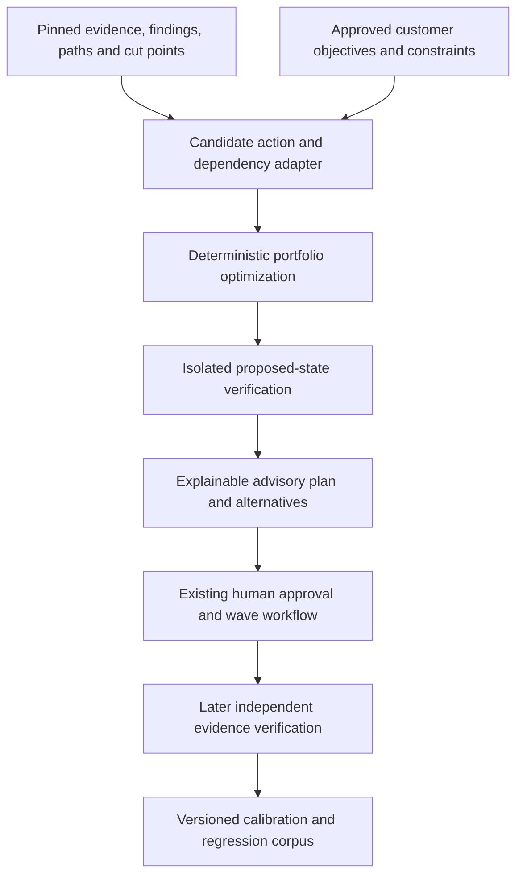

# Constrained remediation portfolio optimization — SecureNow and ArchLucid

**Status:** Proposed architecture; not implemented or validated as a production optimizer.  
**Date:** 2026-11-24  
**Tracking:** [Active technical backlog](../ACTIVE_TECHNICAL_BACKLOG.md), FND-087–093.  
**Source review:** revision `a21b92b90c3daff9ff6cbe034d6d9b88e28e6b6f` (targeted static inspection).  
**Release boundary:** preserve the existing release-first policy; no autonomous execution or customer cloud mutation. Implementation is subject to the existing governance and validation gates.

## 1. Objective and rationale

Move from ranking isolated vulnerabilities to selecting and sequencing a portfolio of remediation actions that maximizes defensible modeled security improvement under customer-specific financial, engineering, operational and policy constraints.

The owner raised this problem during the architecture examination: subjective priorities require adjustable coefficients and logical defaults; dependencies must be explicit; mathematical methods must be selected carefully; decisions must be explainable. Continuous-time differential equations may eventually model risk evolution where credible calibration exists, but action selection is primarily a discrete constrained optimization problem. Start with transparent combinatorial models instead of assuming that a complex differential equation or LLM judgment can establish an optimal solution.

A finding is not an action. One shared-control action may address many findings, several actions may be necessary to remove one risk scenario, and two actions may overlap or conflict. The goal is risk reduction, not the count of tickets closed.

## 2. Existing architecture and reuse

| Existing capability | Reuse / boundary |
| --- | --- |
| [IE-15 prioritization and waves](../library/REMEDIATION_PRIORITIZATION_AND_WAVES.md) | Existing deterministic ranking, tenant-adjustable weights, score breakdowns and operational wave infrastructure; retain current behavior until explicitly migrated. |
| [RemediationRiskScoreEvaluator](../../ArchLucid.Application/InfraEvidence/RemediationPrioritization/RemediationRiskScoreEvaluator.cs) | Candidate score inputs; not a calibrated breach probability or additive portfolio benefit. Validate signs, normalization, missing metadata, rollback risk and sensitivity. |
| [RemediationPrioritizationService](../../ArchLucid.Application/InfraEvidence/RemediationPrioritization/RemediationPrioritizationService.cs) | Scope-aware finding retrieval, metadata, scoring and persistence; reuse rather than introduce a parallel ranker. |
| [RemediationWaveService](../../ArchLucid.Application/InfraEvidence/RemediationWaves/RemediationWaveService.cs) | Existing top-N or explicit resource selection; keep as a baseline. Approved optimized plans may map to waves only through existing approval boundaries. |
| [PathRankingEngine](../../ArchLucid.Application/InfraEvidence/SecureNowArchitect/PathRankingEngine.cs) and [CutPointAnalysisEngine](../../ArchLucid.Application/InfraEvidence/SecureNowArchitect/CutPointAnalysisEngine.cs) | Reuse stored evidence paths, rankings and candidate cut points. A proposed cut point does not itself establish that a particular action removes a path. |
| [Incremental invalidation](../library/SECURENOW_INCREMENTAL_INVALIDATION.md) | Reuse snapshot/diff infrastructure where equivalence to full recomputation is established; FND-083–086 provide the generalization. |
| FND-014–016, FND-027, FND-037, FND-044, FND-046, TB-2410, TB-2412, TB-2415 | Extend existing simulation, approval, dependency, impact and alternatives work; check current implementation before building. Do not fork contracts or create a competing execution pipeline. |

Static observation requiring validation: the existing score evaluator adds a larger positive RemediationRisk contribution when no rollback is defined (0.75 versus 0.25). Establish whether this is an intentional urgency signal or a polarity defect before changing behavior. Keep urgency separate from action feasibility and execution risk. Unknown evidence must not silently become known-safe; review current defaults, including missing exploitation metadata, and explain their limitations. Preserve historical score versioning and backward compatibility.

## 3. Model and data contract

Define versioned, immutable, tenant/workspace/project-scoped planning inputs:

- Evidence snapshot and graph digest, coverage/completeness, collection time, policy version, risk-model version and engine versions.
- Candidate actions with stable identities, action type, affected resources, cited findings and evidence, prerequisites, exclusions, alternative groups, expected changes, rollback feasibility, ownership and verification predicates.
- Financial costs, engineering hours by skill/team, duration, disruption or downtime estimates, windows and budgets; distinguish measured values, human estimates, defaults and unknowns. Do not represent missing cost as free or missing coverage as safe.
- Risk scenarios with stable identity, business consequence, confidence/coverage and relevant paths or exposure conditions. Avoid treating path counts as independent breach probabilities.
- Tenant-approved objective weights, mandatory policy obligations, critical assets, risk tolerances and hard constraints. Pin these for reproducibility. Validate range, units and normalization.
- Planning result containing selected and excluded actions, schedule, predicted impact with assumptions, constraint usage, binding constraints, solver status and bound/gap where available, baseline comparison, source digests and approval state.

Do not duplicate FND-075/076/083 dependency infrastructure. Distinguish computational dependencies (which stages are stale) from remediation dependencies (which actions are prerequisites or mutually exclusive).

## 4. Mathematical formulation

Let binary x_i indicate selection of action i. For a bounded initial model, define a set of risk scenarios p with nonnegative severity/impact weights w_p. A verified action-to-scenario coverage relation is a_pi = 1 only when action i alone is modeled to neutralize scenario p under pinned assumptions. Binary y_p indicates neutralization.

Maximize:

    sum_p w_p * y_p

Subject to:

    sum_i cost_i * x_i <= budget
    sum_i hours_i * x_i <= engineering_capacity
    sum_i disruption_i * x_i <= disruption_limit
    y_p <= sum_i a_pi * x_i
    x_i <= x_j                 # j is a prerequisite of i
    x_i + x_k <= 1             # mutually exclusive actions

With nonnegative scenario weights, the objective drives eligible y_p to one. For zero-weight scenarios and externally reported coverage, explicitly derive y_p from the selected actions rather than trusting an arbitrary solver assignment. Mandatory actions use x_i = 1; infeasibility is an explicit result, not a license to relax safety constraints silently.

The coverage relation is valid only for independently sufficient actions. Where a scenario is removed only by a combination S, introduce a binary z_S that represents the conjunction:

    z_S <= x_i                  # for every i in S
    z_S >= sum_(i in S) x_i - (|S| - 1)

Then allow y_p to reflect the union of sufficient actions and sufficient combinations, counting each scenario once. Multiple alternative attack paths to the same business asset may require a richer scenario model; validate against graph simulation instead of summing path scores as if independent. Do not enumerate exponentially many combinations blindly.

This initial model optimizes a defined ordinal/weighted exposure proxy, not proven real-world monetary loss or breach probability. If defensible probabilistic estimates later become available, version and validate the model before introducing expected-loss objectives. Nonlinear interactions may require explicit scenarios, decomposition or iterative simulation. A time-indexed extension can account for sequencing, skill availability and maintenance windows. Aggregate disruption constraints are only appropriate if the underlying measure is additive; otherwise model service-specific scheduling and conflicts.

## 5. Shared architecture and optimization strategy

Proposed logical flow (names are design suggestions, not existing implementations):

Use a shared solver-neutral domain contract (proposed `IRemediationPortfolioOptimizer`) with product-specific adapters. The initial SecureNow adapter consumes operational security findings and path/cut-point evidence; an ArchLucid adapter can later use architecture modernization, reliability, technical debt and cost scenarios without conflating operational and sealed review finding authority.

1. Baseline: current top-N ranking, filtered by feasible actions; compare on identical pinned input and budgets.
2. Establish a deterministic greedy marginal-benefit baseline with prerequisite bundles and feasibility checks. Do not claim a general approximation guarantee when complementarities, arbitrary conflicts or non-submodular risk invalidate it.
3. Evaluate mixed-integer programming or constraint programming for constrained maximum coverage and scheduling. Select a solver only after licensing, deployment, reproducibility and bounded resource review. Use exact exhaustive enumeration as a separate oracle for small cases.
4. For large estates, use bounded candidate generation, decomposition or heuristics where justified. Report feasible incumbent, bound and gap where available; never label timeout or heuristic results as globally optimal.
5. Use isolated what-if evaluation of proposed actions to verify modeled impacts and surface new or residual paths. Unknown or incomplete evidence must remain visible. No live cloud writes.
6. Offer Pareto alternatives for cost, risk reduction and business disruption; do not disguise an arbitrary weighted sum as the only optimum. For discrete problems, weighted sums can miss nondominated alternatives; use epsilon-constraint or other suitable methods for bounded exploration.

## 6. Explainability and customer experience

Preserve current IE-15 ranking UI. Add a separate proposed-plan view only after validation, with controls for budget, team capacity, disruption limits, policy constraints and planning horizon. Show:

- why an action was selected, including shared root causes, required actions and marginal modeled benefit given the portfolio;
- why a high-ranked finding was not selected (cost, conflict, prerequisite, insufficient evidence, overlap or mandatory priority elsewhere);
- projected remaining exposures and unresolved critical scenarios, not just a single score;
- selected versus alternative portfolios, sensitivity to changes in weights/costs, assumptions and uncertainty;
- solver status, elapsed time, feasibility and optimality bound where meaningful.

Distinguish modeled risk reduction from later verified remediation effectiveness. Example: a shared identity action may cover 180 modeled paths, but overlaps with another action must be deduplicated and path removal independently re-evaluated. Do not turn path counts into financial savings or percent breach-risk reductions without calibration and appropriate evidence.

LLMs may help propose candidate actions and explain results, but must not invent costs, constraints, proof, or solver outcomes. Any LLM-proposed dependency is untrusted until confirmed. Human approval remains mandatory for moving an advisory proposal into an execution workflow; current no-cloud-mutation restrictions remain in effect.

## 7. Independent verification and measurement

- Exact oracle on small graphs: independently enumerate feasible portfolios, check objective values, ties and optimality claims.
- Synthetic graph cases: overlapping coverage, complementary actions, prerequisites, conflicts, mandatory critical actions, newly introduced paths, unknown coverage, infeasible budgets, zero-weight scenarios and missing cost inputs.
- Differential comparisons with current top-N and greedy baselines using same evidence, budgets and action granularity. Report feasible risk-proxy improvement, runtime, peak memory and solver bounds, not only ticket counts.
- Property/metamorphic tests: with unchanged model and relaxed constraints, the true optimum cannot worsen; results do not double-count scenarios or exceed constraints. Test input-order independence and stable tie policy. If heuristic results violate monotonicity, report as algorithmic limitation, not risk truth.
- Independent proposed-state recomputation: check claimed path removal, residual exposure, newly introduced risks and incomplete analysis. Reuse FND-078/079 and FND-086; do not assume incremental equivalence.
- Security and resilience: cross-tenant denial, stale snapshot/policy invalidation, cancellation, timeout, safe fallback, auditability and immutable historical plans. A missing result is never evidence of safety.
- After externally approved remediation, collect later fresh evidence and use existing verification loops to establish what actually changed; calibrate model and estimates with uncertainty. Do not count a simulated or approved action as remediated.

## 8. Implementation slices and acceptance gates

| ID | Slice | Exit evidence |
| --- | --- | --- |
| FND-087 | Validate and harden existing risk-ranking mathematics | Versioned factor semantics, polarity/unknown-value tests and backward compatibility. |
| FND-088 | Shared action dependency and common-root-cause graph | Evidence-bound action identities, validated prerequisites/conflicts and deduplicated coverage. |
| FND-089 | Constrained deterministic portfolio optimizer | Feasible bounded solver, baseline comparison and independent exact small-case oracle. |
| FND-090 | Counterfactual risk and attack-path simulation | Read-only proposed-state verification, residual and newly introduced exposure with coverage honesty. |
| FND-091 | Multi-objective and Pareto alternatives | Nondominance/feasibility checks on bounded cases and explicit tradeoffs. |
| FND-092 | Explainable recommendations and sensitivity analysis | Reproducible versioned rationale, constraint usage, excluded alternatives and uncertainty. |
| FND-093 | Independent optimization verification and effectiveness measurement | Differential/independent test evidence, later snapshot verification, calibration and rollout gate. |

Implement the smallest useful SecureNow slice first. Revalidate pre-existing code and open changes before each implementation. Treat FND-087/088 as foundations; FND-089 should initially be bounded and advisory, with FND-093 assurance developed alongside it. Do not defer all validation to the end. Integrate FND-090/091/092 only when input semantics and evidence support them. Generalize to ArchLucid through adapters after proving reuse, rather than duplicating the solver. Comprehensive builds belong to RC49 under the current owner instruction; use focused checks for master-targeted changes. No production activation or merge is authorized by this design document alone.

## 9. Open decisions

- Which risk proxy and scenario identity can be validated from existing evidence?
- Which default objective weights are justified by independently adjudicated cases?
- Which cost/effort inputs can be collected reliably, and which require customer estimates?
- Which solver meets licensing, deployment, security and performance constraints?
- How should mandatory regulatory and critical exposure constraints be configured, and how should infeasibility escalate?
- Which existing approval and wave contracts support proposed portfolios without automatically creating active work?

These are explicit design decisions for implementation review. This proposal does not claim that portfolio optimization, risk calibration or customer outcomes are already implemented.
