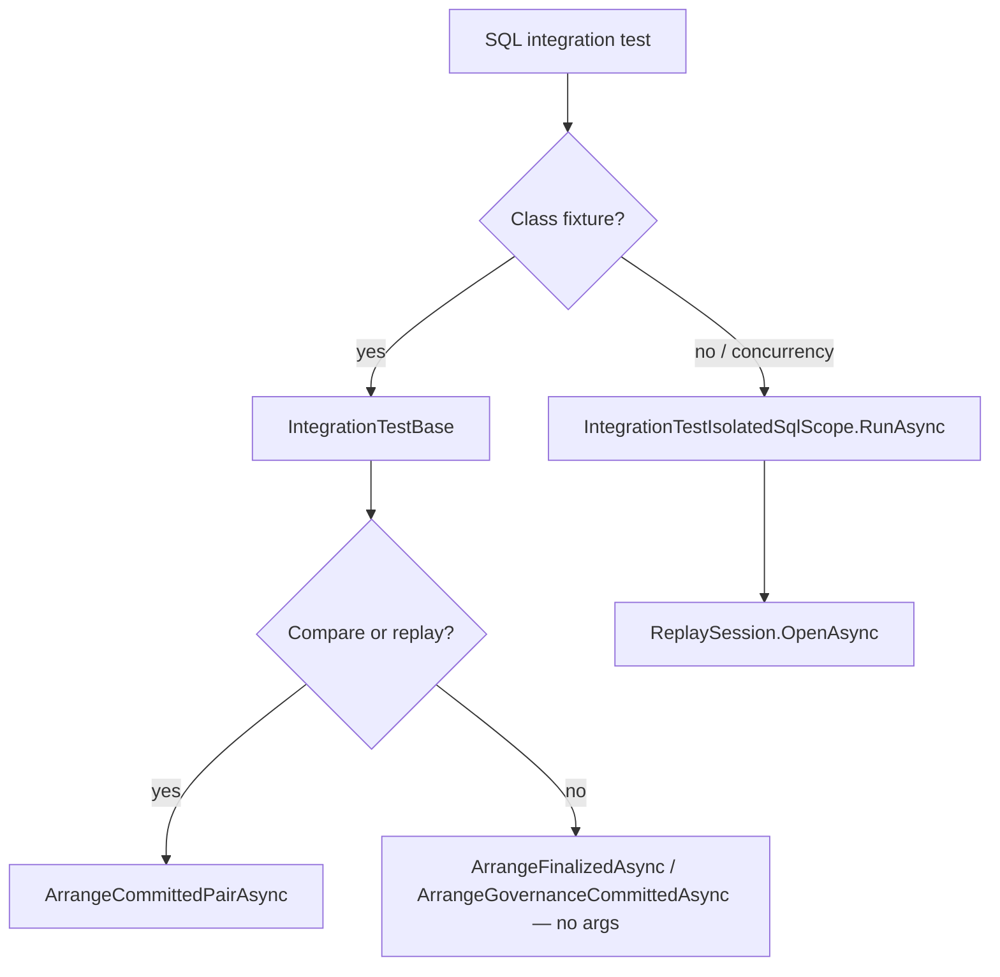

> **Scope:** Contributor-reference — Test structure (Change Set 54R) - full detail, tables, and links in the sections below.

> **Spine doc:** [`START_HERE.md`](../START_HERE.md).


# Test structure (Change Set 54R)

Operator cheat sheet for **ArchLucid** .NET tests: **what each tier means** and **how to run it**. CI job names and full narrative: **[TEST_EXECUTION_MODEL.md](TEST_EXECUTION_MODEL.md)**. SQL variables and LocalDB: **[../engineering/../engineering/BUILD.md](../engineering/BUILD.md)**.

## 54R tiers

| Tier | Meaning | Filter |
|------|---------|--------|
| **Core (corset)** | Curated high-value regression; opt-in per **class** with `[Trait("Suite", "Core")]` | `Suite=Core` |
| **Fast core** | Matches CI **dotnet-fast-core** corset: Core minus **`Slow`**, **`Integration`**, and **`GoldenCorpusRecord`** | `Suite=Core&Category!=Slow&Category!=Integration&Category!=GoldenCorpusRecord` |
| **OpenAPI v1 snapshot** | `OpenApiContractSnapshotTests` only — asserts committed contract JSON (**CI Tier 0.x** runs this before corset build) | `FullyQualifiedName~OpenApiContractSnapshotTests` locally via **`scripts/ci/check_openapi_contract_snapshot.sh`** or **`.\scripts\test.ps1 -Tier OpenApiContract`** — see **[OPENAPI_CONTRACT_DRIFT.md](OPENAPI_CONTRACT_DRIFT.md)** |
| **Integration** | Real API host (`WebApplicationFactory`), HTTP-level behavior | `Category=Integration` |
| **Slow** | Long-running or heavy; excluded from fast core | `Category=Slow` |
| **Performance baseline** | In-process **Stopwatch** gates for the pilot path (simulator + in-memory; not production SQL); see **[PERFORMANCE_BASELINES.md](PERFORMANCE_BASELINES.md)** and **`CorePilotFlowPerformanceTests`** in `ArchLucid.Api.Tests/Performance/` | `Category=Slow` (also `Suite=Core`) |
| **Full regression** | Whole solution, all traits (unless skipped in test code) | *(no filter)* |

### Property-based tests (FsCheck)

**`ArchLucid.Decisioning.Tests`**, **`ArchLucid.Application.Tests`**, and **`ArchLucid.Contracts.Tests`** reference **FsCheck** + **FsCheck.Xunit**. Classes use **`[Property]`** for invariant checks (for example **`ExplainabilityTraceCompletenessAnalyzerPropertyTests`**). They usually carry **`[Trait("Suite", "Core")]`** and run under the same **`dotnet test`** filters as other unit tests.

### Run each (.NET, repo root)

```bash
dotnet test ArchLucid.sln --filter "Suite=Core"
```

```bash
dotnet test ArchLucid.sln --filter "Suite=Core&Category!=Slow&Category!=Integration&Category!=GoldenCorpusRecord"
```

```bash
bash scripts/ci/check_openapi_contract_snapshot.sh
```

**(OpenAPI only — same assertion as CI job `openapi-contract-snapshot`;** regenerate with **`ARCHLUCID_UPDATE_OPENAPI_SNAPSHOT=1`** per [OPENAPI_CONTRACT_DRIFT.md](OPENAPI_CONTRACT_DRIFT.md)**.)**

```bash
dotnet test ArchLucid.sln --filter "Category=Integration"
```

```bash
dotnet test ArchLucid.sln --filter "Category=Slow"
```

```bash
dotnet test ArchLucid.sln
```

**Configuration:** GitHub Actions .NET jobs use **`-c Release`**. `scripts\test-*.cmd` / `scripts\test-*.ps1` call `dotnet test` **without** `-c` (typically **Debug**). To mirror CI: `dotnet test ArchLucid.sln -c Release`.

**Windows:** `.\scripts\test.ps1 -Tier OpenApiContract` runs the OpenAPI snapshot script above. **`scripts\test-core.cmd`**, **`scripts\test-fast-core.cmd`**, … delegate to **`.\scripts\test.ps1`** (same filters).

### Release candidate packaging (56R)

**Doc:** [RELEASE_LOCAL.md](RELEASE_LOCAL.md). **Scripts:** `scripts/build-release`, `scripts/package-release`, `scripts/run-readiness-check` (`.cmd` / `.ps1`). `run-readiness-check` runs a **Release** build, **fast core** tests with `-c Release`, then **Vitest** when Node is on `PATH`. **Pilot onboarding:** [customer-facing/customer-facing/PILOT_GUIDE.md](customer-facing/PILOT_GUIDE.md), [customer-facing/customer-facing/OPERATOR_QUICKSTART.md](customer-facing/OPERATOR_QUICKSTART.md). **E2E release smoke:** [RELEASE_SMOKE.md](RELEASE_SMOKE.md) (`scripts/release-smoke.cmd`).

### SQL Server–first (Persistence Dapper)

Persistence integration against a **real** SQL Server (Dapper + DbUp migrations; **no EF**):

```bash
dotnet test ArchLucid.Persistence.Tests --filter "Category=SqlServerContainer"
```

**Script:** `scripts/test-sqlserver-integration.cmd` / `scripts/test-sqlserver-integration.ps1`

### Greenfield SQL boot (empty catalog + API host)

**Why:** Integration tests that use a **pre-migrated** database never exercise **`ArchLucidPersistenceStartup`** on an **empty** catalog — ordering bugs between **DbUp** and **`SqlSchemaBootstrapper`** can slip through until deploy or live CI.

**What:**

- **`ArchLucid.Api.Tests`**: **`GreenfieldSqlApiFactory`** + **`GreenfieldSqlBootIntegrationTests`** (`Suite=Core`, `Category=Integration`). Each test creates an empty database, boots the real API with **`StorageProvider=Sql`**, asserts **`/health/ready`**, **`dbo.SchemaVersions`**, and core columns.
- **CI**: job **`api-greenfield-boot`** in **`.github/workflows/ci.yml`** (Tier **1.5**) runs the API process against **`ArchLucidGreenfieldCi`** and asserts the DbUp journal.

**Local (requires SQL per [../engineering/../engineering/BUILD.md](../engineering/BUILD.md)):**

```bash
dotnet test ArchLucid.Api.Tests --filter "FullyQualifiedName~GreenfieldSqlBoot" -c Release --settings coverage.runsettings
```

### Architect workspace (`archlucid-ui/`)

**Vitest** (jsdom, fast — minimal harness):

```bash
cd archlucid-ui
npm ci
npm test
```

```bash
npm run test:watch
```

**Playwright** smoke (browser, slower):

```bash
npm run test:e2e
```

**Live API E2E (Tier 2+ — CI `ui-e2e-live` + `ui-e2e-live-apikey`, merge-blocking):** default **`archlucid-ui/playwright.config.ts`** uses **`testMatch: ["live-api-*.spec.ts"]`** (live API + SQL via **`e2e/start-e2e-live-api.ts`**). **`ui-e2e-live`** runs the **full** live suite under **DevelopmentBypass** (`timeout-minutes: 35`), including **axe** routes renamed to **`live-api-accessibility*.spec.ts`**. **`ui-e2e-live-apikey`** starts the API with **`ArchLucidAuth:Mode=ApiKey`**, sets **`LIVE_API_KEY`** / **`LIVE_API_KEY_READONLY`**, and runs a **subset** (`live-api-apikey-auth`, `live-api-journey`, `live-api-negative-paths`) for production-like auth. Specs include: **`live-api-apikey-auth`** (skipped unless `LIVE_API_KEY` is set), **`live-api-journey`**, **`live-api-conflict-journey`**, **`live-api-governance-rejection`**, **`live-api-negative-paths`**, **`live-api-error-states`**, **`live-api-advisory-flow`**, **`live-api-replay-export`**, **`live-api-analysis-report`**, **`live-api-policy-pack-lifecycle`**, **`live-api-compare-runs`**, **`live-api-alert-rules`**, **`live-api-search-ask-graph`**, **`live-api-digest-webhook`**, **`live-api-concurrency`**, **`live-api-archival`**, **`live-api-accessibility`**, **`live-api-accessibility-focus`**. **Nightly** (not a PR gate): **[`live-e2e-nightly.yml`](../../.github/workflows/live-e2e-nightly.yml)** runs the **full** live suite under **DevelopmentBypass** and under **ApiKey** (forks skipped). Auth assumptions: **[LIVE_E2E_AUTH_ASSUMPTIONS.md](LIVE_E2E_AUTH_ASSUMPTIONS.md)**; parity matrix: **[LIVE_E2E_AUTH_PARITY.md](LIVE_E2E_AUTH_PARITY.md)**. **Mock** Playwright (no live API): **`playwright.mock.config.ts`** — `npm run test:e2e` / **`npx playwright test -c playwright.mock.config.ts`**. Helpers: **`e2e/helpers/live-api-client.ts`**. Narrative: **[LIVE_E2E_HAPPY_PATH.md](LIVE_E2E_HAPPY_PATH.md)**. Run locally: `npx playwright test` with API on **`LIVE_API_URL`** (optional **`LIVE_API_KEY`** for ApiKey mode). CI sets **`LIVE_E2E_SKIP_NEXT_BUILD=1`**. See **[TEST_EXECUTION_MODEL.md](TEST_EXECUTION_MODEL.md)**.

**API integration (`Suite=Core`):** HTTP tests for **`/v1/learning/*`**, **`/v1/product-learning/*`**, **`/v1/evolution/*`**, and related classes (e.g. **`LearningControllerTests`**, **`ProductLearningControllerTests`**, **`EvolutionControllerQueryTests`**, **`EvolutionControllerFlowTests`**, **`AskThreadIntegrationTests`**) carry **`[Trait("Suite", "Core")]`** so they are included in the **`Suite=Core`** .NET filter (they remain **`Category=Integration`**, so they still **exclude** from **fast core**).

**Scripts (repo root):** `test-ui-unit.cmd` / `.ps1` (Vitest), `test-ui-smoke.cmd` / `.ps1` (Playwright)

**Change Set 55R — focused review-workflow smoke:** component + mocked API contract tests under `archlucid-ui/src/review-workflow/`, `SidebarNav`, artifact/compare helpers. Command list: [archlucid-ui/docs/TESTING_AND_TROUBLESHOOTING.md](../../archlucid-ui/docs/TESTING_AND_TROUBLESHOOTING.md#3-55r--review-workflow-smoke-tests-change-set-55r). Operator context: [docs/operator-shell.md](operator-shell.md).

### Stryker.NET mutation configs (repo root)

Scheduled CI (`.github/workflows/stryker-scheduled.yml`) runs Stryker per config with **`-s ArchLucid.sln`**, reporters **`progress` / `html` / `json`**, then **`scripts/ci/assert_stryker_score_vs_baseline.py`** vs **`scripts/ci/stryker-baselines.json`** (**mutation score baselines 70.0** per module after the latest ratchet; assert tolerance **0.10** pp). Pull requests also trigger **`.github/workflows/stryker-pr.yml`**, which plans targets with **`scripts/ci/stryker_pr_plan.py`** and runs **`dotnet dotnet-stryker … --since:<base>`** only for affected modules (**`continue-on-error: true`** until policy tightens). Narrative and baseline refresh: **[MUTATION_TESTING_STRYKER.md](MUTATION_TESTING_STRYKER.md)**. Most configs use thresholds **high 80 / low 70 / break 70** (`low` must be ≥ `break` per Stryker.NET; baseline regression in **`stryker-baselines.json`** is a separate script gate). **Persistence** uses **`stryker-config.persistence.json`** (**high 70 / low 55 / break 55**) in scheduled CI.

| Config file | Code project | Test project |
|-------------|--------------|--------------|
| `stryker-config.persistence.json` (alias: `stryker-config.json`) | `ArchLucid.Persistence` | `ArchLucid.Persistence.Tests` |
| `stryker-config.application.json` | `ArchLucid.Application` | `ArchLucid.Application.Tests` |
| `stryker-config.agentruntime.json` | `ArchLucid.AgentRuntime` | `ArchLucid.AgentRuntime.Tests` |
| `stryker-config.decisioning.json` | `ArchLucid.Decisioning` | `ArchLucid.Decisioning.Tests` |
| `stryker-config.persistence-coordination.json` | `ArchLucid.Persistence.Coordination` | `ArchLucid.Persistence.Tests` |
| `stryker-config.api.json` | `ArchLucid.Api` | `ArchLucid.Api.Tests` |
| `stryker-config.decisioning-merge.json` | `ArchLucid.Decisioning` (`**/Merge/**/*.cs` only) | `ArchLucid.Decisioning.Tests` |
| `stryker-config.application-governance.json` | `ArchLucid.Application` (`**/Governance/**/*.cs` only) | `ArchLucid.Application.Tests` |
| `stryker-config.application-commit-critical-paths.json` | `ArchLucid.Application` (governance + commit orchestrator + manifest finalization — see [`docs/testing/MUTATION_TESTING_CRITICAL_PATHS.md`](../testing/MUTATION_TESTING_CRITICAL_PATHS.md)) | `ArchLucid.Application.Tests` |

### k6 performance smoke (Tier 2c — CI automated)

Three k6 scripts run in CI via `.github/workflows/ci.yml` (merge-blocking) and `.github/workflows/k6-soak-scheduled.yml` (non-blocking):

| CI job | Script | Scenarios | Write paths | Blocking |
|--------|--------|-----------|-------------|----------|
| `k6-smoke-api` | `tests/load/k6-api-smoke.js` | Core Pilot-shaped operator path (ready, version, create run, run snapshot, authority list; seed→commit→artifacts unless minimal) | **Yes** (`POST /v1/architecture/request` + internal seed/commit) | Yes — **`assert_k6_ci_smoke_summary.py --per-tag-k6-api-smoke`** (failed rate ≤ 2%) |
| `k6-ci-smoke` | `tests/load/ci-smoke.js` | health live/ready, create run, list runs, audit search, version | **Yes** (`POST /v1/architecture/request`) | **Yes** — `assert_k6_ci_smoke_summary.py` (per-tag p95; failed rate ≤ 2%) |
| `k6-soak-scheduled` | `tests/load/soak.js` | longer low-rate read-only mix | No | No (`continue-on-error`; needs secret **`ARCHLUCID_SOAK_BASE_URL`**) |

Both merge-blocking jobs start the API against a SQL Server service container with `DevelopmentBypass` auth and `Simulator` agent execution mode. k6 is installed as a **native binary** on the Ubuntu runner (Grafana APT repo). The soak job uses the `grafana/k6:latest` Docker image.

**Local (read + write smoke):**

```bash
BASE_URL=http://127.0.0.1:5128 k6 run tests/load/ci-smoke.js --summary-export /tmp/k6-ci-summary.json
```

**Manual full load (Compose full-stack):** `scripts/load/hotpaths.js` via `.github/workflows/load-test.yml` or `scripts/load/record_baseline.ps1` / `.sh`. See **[LOAD_TEST_BASELINE.md](LOAD_TEST_BASELINE.md)**.

### Scheduled security (Tier 4 — not xUnit)

These jobs live in **separate workflows** (weekly + manual dispatch). They do **not** use `dotnet test` traits.

| Workflow file | Tool | Target | When |
|----------------|------|--------|------|
| [`zap-baseline-strict-scheduled.yml`](../../.github/workflows/zap-baseline-strict-scheduled.yml) | OWASP ZAP baseline | API HTTP surface (container) | Monday 06:00 UTC + `workflow_dispatch` |
| [`schemathesis-scheduled.yml`](../../.github/workflows/schemathesis-scheduled.yml) | Schemathesis (OpenAPI-driven fuzz) | `GET /openapi/v1.json` + exercised routes | Same |

**Schemathesis narrative and local commands:** [API_FUZZ_TESTING.md](API_FUZZ_TESTING.md). **ZAP rules:** [security/ZAP_BASELINE_RULES.md](../security/ZAP_BASELINE_RULES.md). **CI tier context:** [TEST_EXECUTION_MODEL.md](TEST_EXECUTION_MODEL.md) (Tier 4).

---

## SQL Server for API + Persistence tests

- **No SQLite.** Use **SQL Server** for anything that hits the DB; tests use **Dapper** and **DbUp** (`ArchLucid.Persistence/Migrations/`).
- **API integration** (`ArchLucid.Api.Tests`): factories create ephemeral databases on the configured instance — set **`ARCHLUCID_SQL_TEST`** or **`ARCHLUCID_API_TEST_SQL`** on Linux/macOS/CI; Windows may use **localhost** + integrated security when unset (see **BUILD.md**).
- **Persistence** (`ArchLucid.Persistence.Tests`): set **`ARCHLUCID_SQL_TEST`**, or on **Windows** without env try **localhost** + integrated security, then **LocalDB** (see **BUILD.md**).
- **CI** sets `ARCHLUCID_SQL_TEST` against the SQL Server service container for the full regression job.

**Example (bash):**

```bash
export ARCHLUCID_SQL_TEST='Server=127.0.0.1,1433;User Id=sa;Password=YourPassword;TrustServerCertificate=True;Initial Catalog=ArchLucidPersistenceTests'
dotnet test ArchLucid.sln
```

**PowerShell:**

```powershell
$env:ARCHLUCID_SQL_TEST = 'Server=127.0.0.1,1433;User Id=sa;Password=YourPassword;TrustServerCertificate=True;Initial Catalog=ArchLucidPersistenceTests'
dotnet test ArchLucid.sln
```

Skip SQL-container or integration slices when needed:

```bash
dotnet test ArchLucid.sln --filter "Category!=SqlServerContainer"
```

```bash
dotnet test ArchLucid.sln --filter "Category!=Integration&Category!=SqlServerContainer"
```

---

## Bounded context map (quick reference)

| Test project | Primary bounded contexts / seams exercised |
|--------------|---------------------------------------------|
| **ArchLucid.Api.Tests** | HTTP API, auth policies, ProblemDetails, CORS, comparison replay, runs, governance, alerts (integration), SQL Server–backed persistence through the real host (**DbUp** on startup). |
| **ArchLucid.Decisioning.Tests** | Findings, compliance, alerts (pure logic), advisory scheduling math, governance resolution, graph mappers, JSON persistence contracts. |
| **ArchLucid.ContextIngestion.Tests** | Connectors, parsers, deduplication, `ContextIngestionService`, delta summaries. |
| **ArchLucid.Coordinator.Tests** | Run coordination, agent fakes, **`ContextIngestionRequestMapperTests`**, **`DocxExportServiceGoldenTests`** (OpenXML anchors). |
| **ArchLucid.Application.Tests** | **`ArchitectureRunService`** execute/commit and idempotency, **`ReplayRunService`**, **`DeterminismCheckService`**, hashing helpers — Application-layer orchestration with mocked Data/Coordinator ports (**`Suite=Core`** on classes). **`AuthorityRunOrchestratorTests`** and **`AuthorityPipelineStagesExecutorTests`** exercise **`ArchLucid.Application.Runs.Orchestration`** (commit vs rollback, stage spans, histogram **`archlucid_authority_pipeline_stage_duration_ms`**, **`Suite=Core`**). |
| **ArchLucid.Decisioning.Tests** (`Merge/`, `Validation/`) | Schema validation, manifest merge, decision-engine v2 scenarios. |
| **ArchLucid.KnowledgeGraph.Tests** | Graph models, edge inference contracts. |
| **ArchLucid.Retrieval.Tests** | `RetrievalQueryService`, `InMemoryVectorIndex` (empty index, ranking, scope filters), **`CircuitBreakerGateTests`**, **`CircuitBreakingOpenAiEmbeddingClientTests`** (OpenAI embedding circuit breaker). |
| **ArchLucid.Persistence.Tests** | Dapper repositories against **real SQL Server** via **`ARCHLUCID_SQL_TEST`**, or Windows **localhost** (integrated security) then **LocalDB** when unset; schema from **`DatabaseMigrator`** (same DbUp migrations as production SQL Server). **`Contracts/`** abstract bases with **InMemory** + **Dapper** implementations (agent evaluations, decision nodes, coordinator manifest/trace, run exports, architecture runs, etc.). **53R / relational cutover:** `CutoverReadinessReportTests` (unit), `CutoverReadinessSqlIntegrationTests` (SQL). Relational read behavior is covered by repository SQL integration tests (e.g. `SqlGraphSnapshotRepositorySqlIntegrationTests` for edge JSON merge). |

## API routes ↔ primary automated tests (319R)

Many flows are covered by **scenario-named** integration tests under **`ArchLucid.Api.Tests`**, not by a `*ControllerTests` class per MVC controller. Use this map when tracing a route to tests (representative examples; search the test project for the route segment or DTO name when unsure).

| Area / route prefix (typical) | Primary test classes (Api.Tests) |
|------------------------------|-----------------------------------|
| **`/v1/architecture/*`** (runs, commit, replay, determinism, traces) | **`ArchitectureRunDetailsTests`**, **`ArchitectureReplayTests`**, **`ArchitectureDeterminismTests`**, **`ArchitectureTraceTests`**, **`ArchitectureCommitConflictTests`**, **`ArchitectureControllerTests`** |
| **Comparisons & replay export** | **`ArchitectureComparisonReplayTests`**, **`ArchitectureEndToEndComparisonTests`**, **`ComparisonReplayVerifyDriftIntegrationTests`**, **`BatchReplayIntegrationTests`** |
| **Governance** | **`GovernanceControllerTests`**, **`GovernancePreviewControllerTests`**, **`GovernanceWorkflowServiceTests`** |
| **Policy packs** | **`PolicyPacksIntegrationTests`**, **`PolicyPacksAppServiceTests`** |
| **Manifests / diagrams / summaries** | **`ManifestSummaryServiceTests`**, **`ManifestDiagramServiceTests`**, **`ArchitectureDiagramTests`**, **`ArchitectureSummaryTests`** |
| **Exports & analysis reports** | **`ArchitectureAnalysisReportTests`**, **`ArchitectureAnalysisExportTests`**, **`ArchitectureExportAuditTests`** |
| **Configuration & startup** | **`ArchLucidConfigurationRulesTests`**, **`StartupConfigurationFactsReaderTests`**, **`OpenApiContractSnapshotTests`** |
| **Alerts, advisory, retrieval** (when not using dedicated factories) | Search **`Alert*`**, **`Advisory*`**, **`RetrievalQuerySmokeIntegrationTests`**, **`AskThreadIntegrationTests`** |

**Persistence / Application parity:** coordinator Data contracts and **`AuthorityRunOrchestrator`** behavior are also covered in **`ArchLucid.Persistence.Tests`** and **`ArchLucid.Application.Tests`** so logic is testable without **`WebApplicationFactory`**.

## Projects (detail)

- **ArchLucid.Api.Tests** — API integration tests using `WebApplicationFactory` (full app, **SQL Server** per factory via **`ArchLucidApiFactory`**). Heavier; use for HTTP contracts, comparison replay, exports, run-not-found, 422/409. Advisory + alerts: **`AlertLifecycleIntegrationTests`**, **`DigestDeliveryLifecycleIntegrationTests`**, **`RetrievalQuerySmokeIntegrationTests`**, **`AskThreadIntegrationTests`** with **`AlertLifecycleWebAppFactory`**. Resilience and unit-style classes: see source tree; many use **`[Trait("Category", "Unit")]`** or **`Integration`**.
- **ArchLucid.Decisioning.Tests** — Under `Validation/` and `Merge/`; unit and scenario tests; optional integration with real JSON schemas (`SchemaValidationIntegrationTests`).
- **ArchLucid.ContextIngestion.Tests** — Fast unit tests for ingestion parsers, deduplication, connectors, **`ContextIngestionService`**.
- **ArchLucid.Coordinator.Tests**, **ArchLucid.AgentRuntime.Tests**, **ArchLucid.Decisioning.Tests**, **ArchLucid.Retrieval.Tests**, etc. — Domain/component tests unless marked integration.
- **ArchLucid.Persistence.Tests** — SQL integration and contract tests (`Contracts/`); **`Category=SqlServerContainer`** for Dapper against SQL Server. InMemory contract subclasses run under **`Category=Unit`** / **`Suite=Core`**. Authority orchestrator unit tests live in **`ArchLucid.Application.Tests`** (**TB-302**).
- **ArchLucid.Application.Tests** — **`ArchitectureRunService`**, **`ReplayRunService`**, **`DeterminismCheckService`**, idempotency hashing; **`Suite=Core`** on classes.

## Class-level traits (authors)

Use **`[Trait("Suite", "Core")]`** only when a class is intentionally part of the corset. Also set **`[Trait("Category", "Unit")]`**, **`Integration`**, **`SqlServerContainer`**, or **`Slow`** so fast core / integration / SQL filters stay accurate.

A class name may include *Integration* while **`Category=Unit`** when it does not use **`WebApplicationFactory`** / HTTP (e.g. in-process service wiring). Traits govern filters, not filenames.

**Core + slow or integration:** A class may be `Suite=Core` and also `Category=Slow` or `Category=Integration` — it runs in full Core and full regression, but **drops out of fast core**.

## Categories (extra filters)

**Integration** (typical pattern in Api.Tests):

```csharp
[Trait("Category", "Integration")]
```

**SQL Server container** (Persistence):

```csharp
[Trait("Category", "SqlServerContainer")]
```

**Unit-only slice:**

```bash
dotnet test ArchLucid.sln --filter "Category=Unit"
```

**Exclude integration:**

```bash
dotnet test ArchLucid.sln --filter "Category!=Integration"
```

## Fixtures and shared setup

**Two front doors (SQL lifecycle tests):**

1. **`IntegrationTestBase` + `ArchLucidApiFactory`** — class fixture; `InitializeAsync` uses **`IntegrationTestSqlClientBootstrap`**.
2. **`IntegrationTestIsolatedSqlScope.RunAsync`** — one-off factory/client when a class fixture is unnecessary.

Do **not** mix (1) and (2) in the same test class — guard fact **#25**.



Specialty auth, marketing, or multi-tenant security tests may use other factories; see **`AdminApiKeyIntegrationTestBase`** and **`IntegrationTestTenantIsolationClients`**.

- **IntegrationTestBase** — `HttpClient`, `JsonOptions` (`CreateApiJsonOptions` / `CreateRelaxedEscapingJsonOptions`), `JsonContent`. Use **`CreateFinalizedRunAsync`** → **`FinalizedRun`** (not tuple deconstruction).
- **IntegrationTestRunLifecycleSupport** — canonical routes and helpers (listed in the helper table; guarded by **`IntegrationTestHarnessDocumentationGuardSupport`**).
- **ReplaySession** — `OpenCommittedPairAsync` / `CommitAndReplayAsync` → **`CommittedReplayPair`**; prefer **`IntegrationTestBase.Replay`** or **`ReplaySession.OpenAsync`**.

### Api integration harness — which helper?

| Goal | Use |
|------|-----|
| Parallel-safe request id | **`TestRequestIds.ForScenario`** (avoid redundant `ForScenario(nameof(fixture))` on **`IntegrationTestBase`** — guard **#34**) |
| One-verb arrange module | **`HarnessArrange`** (`FinalizedAsync`, `GovernanceCommittedAsync`, `CommittedPairAsync`) — replaces `ArchitectureScenario` / `GovernanceScenario` |
| Finalize in one verb | **`ArrangeFinalizedAsync()`** (no arguments; scenario = fixture class + caller test) → **`FinalizedRun`** (**`RequestId`**, **`RunGuid`**, **`SystemName`**) |
| Committed replay pair | **`ArrangeCommittedPairAsync()`**; **`CommittedReplayPair.PersistEndToEndComparisonForTestAsync`**, **`ReadEndToEndCompareExportMarkdownAsync`** |
| Intake run only | **`CreateRunForTestAsync()`** → **`CreatedRunForTest`** (**`RunGuid`**, **`SystemName`**) |
| Intake + execute (no finalize) | **`RunReadyForExecuteAsync()`** → **`CreatedRunForTest`** |
| Manifest summary / run reads after finalize | **`GetManifestSummaryAsync`**, **`GetRunDetailsAsync`**, **`GetEvidenceAsync`**, **`GetTracesAsync`**, **`GetDecisionsAsync`**, **`GetRoiAsync`**, **`GetExportsHistoryAsync`**, **`GetAuthorityRunSummaryAsync`**, **`ListAuthorityReviewsForProjectAsync`**, **`PostAnalysisReportAsync`**, **`PostAnalysisReportMarkdownExportAsync`**, **`PostAnalysisReportDocxHttpAsync`** on **`FinalizedRun`** |
| Run reads after intake / execute (no finalize) | **`GetRunHttpAsync`**, **`GetEvidenceAsync`**, **`GetTracesAsync`**, **`PatchPinAsync`**, **`GetAuthorityRunSummaryAsync`** on **`CreatedRunForTest`** |
| Authority GET/POST without raw URLs | **`AuthorityHarnessExtensions`** (`GetAuthorityReviewSummaryHttpAsync`, `GetAuthorityProjectReviewsHttpAsync`, `ReadAuthorityProjectReviewsAsync`, `ReadAuthorityProjectReviewsQueryAsync`, `GetAuthorityReviewsInScopeHttpAsync`, `ReadAuthorityReviewsInScopeAsync`) |
| Stable negative-path GUIDs | **`HarnessWellKnownGuids`** |
| Analysis report POST body | **`HarnessAnalysisReportRequestFactory.CreateDefaultJsonContent`** |
| Authority-complete execute skip | **`HarnessSkipWhen.AuthorityPipelineCompleteOnCreateAsync`** |
| Async job poll | **`IntegrationTestJobPollSupport.PollJobUntilSucceededOrFailedAsync`** |
| Pin-aware execute on `IntegrationTestBase` | **`ExecuteForTestAsync`** only (not `PostExecuteWithPinsAsync`) |
| Stable skip strings (authority complete on create) | **`HarnessSkipReasons`** |
| Idempotency-Key header value for custom POSTs | **`TestRequestIds.IdempotencyKey`** |
| Governance committed run arrange | **`ArrangeGovernanceCommittedAsync()`** — finalize-only today (governance submit in test body); see **`HarnessArrange.GovernanceCommittedAsync`** XML |
| Governance self-approval problem JSON | **`GovernanceProblemAssertions.AssertGovernanceSelfApprovalAsync`** |
| Tenant isolation greenfield primer | **`TenantIsolationScenario.WithGreenfieldPrimerAsync`** |
| Tenant A + tenant B clients | **`TenantIsolationScenario.WithTwoScopedClientsAsync`** |
| Full ladder wiring smoke | **`HarnessGoldenPathSmokeTests`** (`Suite=Core`) |
| Standard intake POST (factory body or object) | **`PostArchitectureRequestForTestAsync`** or **`CreateArchitectureRunForTestAsync`** |
| JWT, custom body, or idempotency header on intake | **`CreateArchitectureRequestMessage`** → `SendAsync` |
| Greenfield SQL with transient 503 retry + unique idempotency key | **`PostGreenfieldArchitectureRequestForTestAsync`** |
| Execute / finalize / replay routes | **`ExecuteReviewRelativeUrl`**, **`FinalizeReviewRelativeUrl`**, **`ReplayReviewRelativeUrl`**, **`ComparisonReplayRelativeUrl`**, **`ArchitectureRequestRelativeUrl`**, **`EndToEndCompareSummaryRelativeUrl`**, **`EndToEndCompareExportMarkdownRelativeUrl`**, **`EndToEndCompareExportDocxRelativeUrl`**, **`EndToEndCompareExportFileRelativeUrl`**, **`PostExecuteForTestAsync`**, **`PostExecuteAndEnsureArchitectureVersionPinForTestAsync`**, **`PostFinalizeForTestAsync`**, **`PostReviewReplayForTestAsync`**, **`PostComparisonReplayForTestAsync`** |
| Run through execute + finalize (low-level) | **`CreateFinalizedRunForTestAsync`**, **`CreateRunExecuteAndFinalizeForTestAsync`**, **`CreateFinalizedRunAsync(requestId)`** on **`IntegrationTestBase`** — fixtures prefer **`ArrangeFinalizedAsync`** |
| Comparison / replay arrange | **`ArrangeCommittedPairAsync`** → **`CommittedReplayPair`**; protocol tests may use **`PostReviewReplayForTestAsync`**, **`PostComparisonReplayForTestAsync`** |
| SQL integration client (bounded + scope headers + workspace pin) | **`IntegrationTestSqlClientBootstrap.CreateSqlIntegrationClientAsync`** |
| Per-test isolated SQL factory | **`IntegrationTestIsolatedSqlScope.RunAsync`** |
| Isolated SQL + replay | **`IntegrationTestIsolatedSqlScope.RunWithReplayAsync`** |
| Persist or query end-to-end compare summary | **`PostPersistEndToEndComparisonForTestAsync`** → **`PersistedComparison`**; **`PostEndToEndCompareSummaryForTestAsync`** |
| End-to-end compare export (markdown, docx, file, ranged file) | **`GetEndToEndCompareExportMarkdownForTestAsync`**, **`GetEndToEndCompareExportDocxForTestAsync`**, **`GetEndToEndCompareExportFileForTestAsync`**, **`CreateEndToEndCompareExportFileRangeGetRequestForTest`** (each accepts **`CommittedReplayPair`** or run ids) |
| JSON after HTTP success | **`ReadJsonForTestAsync`** (not `Content.ReadFromJsonAsync` in harness-tagged tests) |
| Binary / export bodies after HTTP success | **`ReadBytesForTestAsync`** |
| RFC 9457 negative paths | **`AssertProblemForTestAsync`** (optional **`detailContains`**; not `ReadJsonForTestAsync` on Problem Details) |
| JSON body for requests | **`IntegrationTestHttpContent.CreateJson`** + **`CreateApiJsonOptions()`** |
| Assert HTTP success with CI-friendly logs | **`EnsureSuccessForTestAsync`** |
| Admin API-key clients | **`AdminApiKeyIntegrationTestBase.CreateAdminClient`** / **`CreateReaderClient`** |
| Security primer + scoped clients | **`IntegrationTestTenantIsolationClients`** |

**Anti-patterns (harness `#26`–`#45`):** no **`FinalizeLifecycleAsync`**; no **`CreateFinalizedRunAsync(variable)`** on fixtures; no literal **`Idempotency-Key`** headers; no direct **`Client.PostExecuteAndEnsureArchitectureVersionPinForTestAsync`** on fixtures (use **`ExecuteForTestAsync`**); no duplicated **`Skip.If`** literals (use **`HarnessSkipReasons`** / **`HarnessSkipWhen`**); no **`ReadJsonForTestAsync`** for problem bodies; no explicit arguments to **`Arrange*Async`**; no redundant **`TestRequestIds.ForScenario(nameof(FixtureClass))`** on **`IntegrationTestBase`**; no raw **`/v1/architecture/manifest/…/summary`** URLs (use **`GetManifestSummaryAsync`**); no raw **`/v1/architecture/review/…/`** subresource GET/POST URLs (use harness extensions — guard **#38** includes **`PostAsync`**); no bare **`Client.GetAsync($"/v1/architecture/review/{…}")`** (use **`GetRunHttpAsync`** / **`GetRunDetailsAsync`**); no raw **`/v1/authority/`** URLs on harness fixtures (use **`AuthorityHarnessExtensions`** or **`FinalizedRun`** authority helpers); no **`JsonDocument.Parse`** in harness fixtures (use **`ReadJsonForTestAsync`** / **`AssertProblemForTestAsync`** — keep **`#40`** allowlist ≤ **`MaxJsonDocumentAllowlistedSourceFiles`** (**14**)); no inline **`Guid.Parse("00000000-…")`** unknown-run literals (use **`HarnessWellKnownGuids`**); no **`SystemNameForRequest(record.RequestId)`** when **`record.SystemName`** exists; keep **`#38`** subresource allowlist ≤ **`MaxReviewSubresourceAllowlistedSourceFiles`** (**12**); keep **`#42`** authority allowlist ≤ **`MaxAuthorityAllowlistedSourceFiles`** (**10**); keep **`HarnessGoldenPathSmokeTests`** **`[SkippableFact]`** count at or above **`MinHarnessGoldenPathSmokeSkippableFacts`** (**10**).

**ReadFromJson burn-down order (allowlist):** `ArchitectureControllerTests` → concurrency support → `LearningControllerTests` / `ProductLearningControllerTests` → `EvolutionController*` → `PolicyPacksIntegrationTests` → `FinalizeConflictSqlIntegrationTests`.

**JsonDocument burn-down (#40 allowlist):** learning/evolution controllers, batch replay, policy-pack validation, pilot deltas — migrate to **`AssertProblemForTestAsync`** / **`ReadJsonForTestAsync`** before adding new allowlist rows.

**Review subresource URL burn-down (#38 allowlist):** evidence uploads → findings CSV/inspect → `TraceabilityBundleZipEndpointTests`. **`ArchitectureAnalysisExportTests`** uses **`PostAnalysisReportMarkdownExportAsync`** (removed from allowlist in slice 16).

**Authority URL burn-down (#42 allowlist):** page-bundle fixtures, replay isolation — migrate to **`AuthorityHarnessExtensions`** before adding allowlist rows. **`AuthorityQueryControllerListRunsPagedIntegrationTests`** migrated in slice 16.

**Source-scan guards** — `IntegrationTestHarnessGoldenPathGuardTests` (`Suite=Core`, **forty-five** scanner facts + catalog/metadata). Global allowlist cap **`MaxHarnessAllowlistedSourceFiles`** (**40**); **`ReadFromJsonAsync`** sub-cap **`MaxReadFromJsonAllowlistedSourceFiles`** (**12**).

**Fast harness CI slice:** `dotnet test ArchLucid.Api.Tests --filter Suite=Core`

**Guard regression slice:** `dotnet test ArchLucid.Api.Tests --filter FullyQualifiedName~IntegrationTestHarnessGoldenPathGuardTests`

**Unit-style tests in Api.Tests** that do not extend **IntegrationTestBase** are often tagged **`Category=Unit`**.

No separate unit-only test project; filter by category as above.
